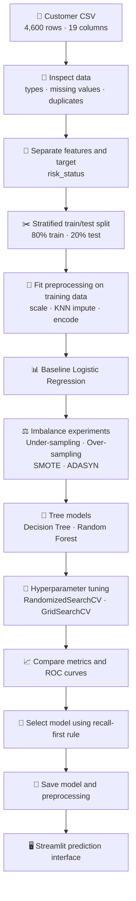
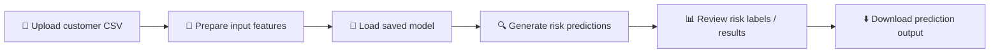

::: {align="center"}
# 🛡️ Risk Alert Classifier

### A Supervised Machine Learning Project for Early Risk Identification in Digital Banking

**Built by Dushyant V**

```{=html}
<p>
```
``{=html}
``{=html}
``{=html}
``{=html}
``{=html}
```{=html}
</p>
```
**Turning customer data into an explainable early-warning workflow.**
:::

------------------------------------------------------------------------

## 📌 Table of Contents

-   [👋 Project Overview](#-project-overview)
-   [🎯 Business Problem](#-business-problem)
-   [📊 Dataset at a Glance](#-dataset-at-a-glance)
-   [🧭 End-to-End Workflow](#-end-to-end-workflow)
-   [🧰 Technology Stack](#-technology-stack)
-   [🧹 Data Preparation](#-data-preparation)
-   [🤖 Models and Experiments](#-models-and-experiments)
-   [📏 Evaluation Strategy](#-evaluation-strategy)
-   [🏆 Results and Key Findings](#-results-and-key-findings)
-   [💻 Code Highlights](#-code-highlights)
-   [🚀 Run the Project Locally](#-run-the-project-locally)
-   [🖥️ Streamlit Application](#️-streamlit-application)
-   [📁 Repository Structure](#-repository-structure)
-   [⚠️ Limitations and Responsible
    Use](#️-limitations-and-responsible-use)
-   [🔭 Future Improvements](#-future-improvements)
-   [🎓 What I Learned](#-what-i-learned)
-   [📬 Author](#-author)
-   [📄 Licence](#-licence)

------------------------------------------------------------------------

## 👋 Project Overview

I built **Risk Alert Classifier** to explore how supervised machine
learning can help a digital banking team identify customer records that
may need an earlier risk review.

The project follows a practical machine-learning workflow: understand
the data, prepare the features, establish a baseline, address class
imbalance, compare models, tune hyperparameters, evaluate results, and
package the selected model for an application.

I wanted this to be more than a model that returns a label. The goal was
to understand **why a model makes a prediction, how its mistakes affect
a business, and what should be checked before anyone relies on its
output.**

> **Project focus:** identify the positive (high-risk) class while
> paying particular attention to false negatives --- high-risk records
> that the model fails to flag.

## 🎯 Business Problem

Imagine a digital bank with thousands of customer records. A risk team
cannot manually investigate every account with the same level of
urgency. An early-warning classifier can help prioritise records for
further human review.

The notebook treats:

  Target value   Meaning
  -------------- -----------
  `0`            Low Risk
  `1`            High Risk

The classifier is a **decision-support prototype**, not a fraud verdict
or an automated decision system. A prediction indicates a record that
may deserve review; it does not establish wrongdoing or prove that a
customer will default.

### Why class imbalance matters

High-risk examples are a minority in this dataset. A model could achieve
apparently strong accuracy by mostly predicting the majority class,
while missing many of the records that matter most. For this reason, the
project compares recall, F1-score, ROC-AUC, and confusion-matrix errors
alongside accuracy.

## 📊 Dataset at a Glance

The supplied CSV contains **4,600 rows and 19 columns**.

  Dataset characteristic                   Value
  ------------------------------------- --------
  Customer records                         4,600
  Original columns                            19
  Low-risk records (`0`)                   4,043
  High-risk records (`1`)                    557
  High-risk share                         12.11%
  Duplicate rows reported in notebook          0
  Training records (80%)                   3,680
  Test records (20%)                         920
  Prepared feature columns                    28

The original columns include customer demographics, employment
information, income and credit indicators, transaction activity, account
behaviour, and the target label. Examples include `age`,
`employment_type`, `annual_income_inr`, `credit_score`,
`missed_payments_12m`, `monthly_transaction_count`,
`failed_login_attempts_3m`, `debt_balance_inr`, and `risk_status`.

**Target distribution**

``` text
Low Risk  (0)  4,043  | ████████████████████████████████████ 87.89%
High Risk (1)    557  | █████                                  12.11%
```

The bar illustration is a text summary of the class counts, not a
substitute for the notebook's generated chart.

## 🧭 End-to-End Workflow

The project follows this sequence:



### Data-leakage safeguards used in the notebook

-   The target `risk_status` is separated from the input features.
-   `customer_id` is removed from the predictive feature set.
-   The train/test split is stratified to preserve class proportions.
-   Numeric scaling and KNN imputation are fitted on training data, then
    applied to test data.
-   Categorical missing values are filled using the most frequent
    training category.
-   One-hot encoded test columns are aligned to the training feature
    columns.
-   Resampling is performed on training data only. The same untouched
    test set is used for comparisons.

## 🧰 Technology Stack

  -----------------------------------------------------------------------
  Tool / library                      How it is used
  ----------------------------------- -----------------------------------
  Python                              Main programming language

  pandas, NumPy                       Data loading and manipulation

  Matplotlib                          Charts and visual comparisons

  scikit-learn                        Preprocessing, classifiers, metrics
                                      and model selection

  imbalanced-learn                    Under-sampling, over-sampling,
                                      SMOTE and ADASYN

  joblib                              Saving the model and preprocessing
                                      artefacts

  Jupyter Notebook                    Experimentation, explanations and
                                      reporting

  Streamlit                           Browser-based interface for
                                      predictions
  -----------------------------------------------------------------------

The notebook imports and uses `StandardScaler`, `KNNImputer`,
`LogisticRegression`, `DecisionTreeClassifier`,
`RandomForestClassifier`, `RandomizedSearchCV`, `GridSearchCV`,
classification metrics, and the sampling methods listed above.

## 🧹 Data Preparation

The preparation process is designed to keep the test data separate from
training-time fitting.

1.  Read the supplied CSV and inspect its dimensions, columns, data
    types, missing values, duplicates, and target counts.
2.  Convert `last_transaction_date` into month and day features.
3.  Remove `customer_id` and the original date text column.
4.  Separate `X` (input features) from `y` (`risk_status`).
5.  Split into training and test subsets using `test_size=0.20`,
    `random_state=42`, and `stratify=y`.
6.  Scale numeric training features before KNN imputation so large
    currency values do not dominate distance calculations.
7.  Fit `KNNImputer(n_neighbors=5)` on scaled training features and
    transform the test features.
8.  Fill missing categorical values with the most frequent category
    found in the training set.
9.  One-hot encode categorical columns and align test columns with the
    training columns.

After preparation, the notebook reports zero missing values in both
prepared sets and a feature matrix with 28 columns.

## 🤖 Models and Experiments

### 1. Baseline --- Logistic Regression

Logistic Regression provides a starting point for comparison. It
estimates class probabilities and predicts the high-risk class according
to its classification threshold.

### 2. Imbalance-handling experiments

The notebook trains Logistic Regression with the following approaches:

  -----------------------------------------------------------------------
  Technique               What it does            Trade-off to consider
  ----------------------- ----------------------- -----------------------
  Under-sampling          Removes examples from   May discard useful
                          the majority class      majority-class
                                                  information

  Over-sampling           Repeats minority-class  Can increase
                          examples                overfitting risk

  SMOTE                   Creates synthetic       Synthetic points may
                          minority examples using not represent every
                          neighbouring            real-world pattern
                          observations            

  ADASYN                  Generates more          May emphasise noisy or
                          synthetic examples      difficult examples
                          around harder minority  
                          observations            
  -----------------------------------------------------------------------

All resampling is applied to the training set only.

### 3. Tree-based models

-   **Decision Tree:** learns a sequence of feature-based rules. It can
    be easy to interpret, but may overfit.
-   **Random Forest:** combines multiple decision trees. The notebook
    compares training and test accuracy to examine generalisation.

### 4. Hyperparameter tuning

The notebook uses:

-   **RandomizedSearchCV** to explore selected Decision Tree and Random
    Forest parameter combinations.
-   **GridSearchCV** to fine-tune the model family selected from the
    cross-validation recall results.

Recall is used as the search scoring metric because the project
prioritises finding high-risk customers. The notebook uses a
deliberately small search space and `cv=2` to keep the exercise
practical within the available project time.

## 📏 Evaluation Strategy

The notebook compares models using the following measures:

  -----------------------------------------------------------------------
  Metric                  What it tells us        Why it matters here
  ----------------------- ----------------------- -----------------------
  Accuracy                Overall share of        Useful context, but can
                          correct predictions     hide minority-class
                                                  failures

  Precision               Share of predicted      Helps understand
                          high-risk records that  unnecessary alerts
                          are truly high risk in  
                          the labelled test data  

  Recall / TPR            Share of actual         Directly reflects
                          high-risk records       missed-risk reduction
                          correctly identified    

  F1-score                Harmonic mean of        Balances missed cases
                          precision and recall    and false alerts

  FPR                     Share of actual         Helps estimate
                          low-risk records        avoidable review
                          incorrectly flagged     workload

  ROC-AUC                 Ranking/separation      Compares probability
                          ability across          scores beyond one
                          thresholds              threshold

  Confusion matrix        Counts TN, FP, FN and   Makes the types of
                          TP                      classification errors
                                                  concrete
  -----------------------------------------------------------------------

### Confusion matrix: business interpretation

``` text
                         PREDICTED
                    Low Risk     High Risk
ACTUAL Low Risk        TN           FP
       High Risk       FN           TP
```

-   **True Negative (TN):** low-risk record correctly left unflagged.
-   **False Positive (FP / Type-I error):** low-risk record flagged for
    review.
-   **False Negative (FN / Type-II error):** high-risk record missed by
    the model.
-   **True Positive (TP):** high-risk record correctly flagged.

For this project, false negatives are especially important. However,
reducing false negatives without considering false positives can create
an unmanageable review queue. A real organisation should choose a
threshold based on its operational capacity and the relative cost of
each error.

## 🏆 Results and Key Findings

The figures below are taken from the saved notebook outputs for the
supplied dataset and its current train/test split.

### Baseline Logistic Regression

  Metric                    Test result
  ----------------------- -------------
  Accuracy                       1.0000
  Precision (high-risk)          1.0000
  Recall (high-risk)             1.0000
  F1-score (high-risk)           1.0000
  ROC-AUC                        1.0000
  True negatives                    809
  False positives                     0
  False negatives                     0
  True positives                    111

### Decision Tree and Random Forest

  ---------------------------------------------------------------------------
  Model             Train         Test    High-risk     F1-score      ROC-AUC
                 accuracy     accuracy       recall              
  ---------- ------------ ------------ ------------ ------------ ------------
  Decision         1.0000       0.9761       0.8559       0.8962       0.9242
  Tree                                                           

  Random           1.0000       0.9989       0.9910       0.9955       0.9999
  Forest                                                         
  ---------------------------------------------------------------------------

### Tuned versus untuned tree models

  Model                     Accuracy   High-risk recall   F1-score   ROC-AUC
  ----------------------- ---------- ------------------ ---------- ---------
  Untuned Decision Tree       0.9761             0.8559     0.8962    0.9242
  Untuned Random Forest       0.9989             0.9910     0.9955    0.9999
  Tuned Random Forest         0.9978             1.0000     0.9911    0.9999

### Tuning details

The best Random Forest cross-validation recall from RandomizedSearchCV
was **0.9372**. The subsequent GridSearchCV best cross-validation recall
was **0.9439**.

The selected GridSearchCV parameters were:

``` python
{
    "class_weight": "balanced",
    "max_depth": None,
    "min_samples_leaf": 4,
    "min_samples_split": 10,
    "n_estimators": 60
}
```

### Model selected by the notebook's stated rule

The final comparison sorts by high-risk recall first, then F1-score,
then ROC-AUC. Under that rule, the notebook selects **Baseline Logistic
Regression**:

-   High-risk recall: **1.000**
-   F1-score: **1.000**
-   ROC-AUC: **1.000**
-   False negatives: **0**
-   False positives: **0**

The resampling comparison also reports ROC-AUC of 1.000 for each
sampling experiment; their accuracy is 0.9978, compared with 1.0000 for
the baseline. Review the full notebook table for the individual recall
and F1 values.

### ⚠️ Important interpretation: perfect scores need validation

A perfect test result is unusual for a real-world banking risk problem.
It should be treated as a finding to investigate, not as proof that the
model will be perfect on future customers.

The notebook excludes the customer identifier and target from the
features, fits preprocessing on training data, and keeps the test set
out of resampling. Even so, additional checks are necessary:

-   Investigate how the dataset and its labels were created.
-   Check for duplicated or highly related records and possible target
    leakage in the source data.
-   Test on a genuinely later time period or a separate external
    dataset.
-   Review feature definitions with banking subject-matter experts.
-   Evaluate fairness, privacy, stability, and operational impact.
-   Revisit the classification threshold using the cost of missed alerts
    and false alarms.

The baseline is the model selected by the notebook's metric-based rule
on this particular split. It is **not yet a production-validated banking
model**.

## 💻 Code Highlights

These examples are taken from the notebook's approach and are included
to make the workflow easy to review.

### 1. Stratified train/test split

``` python
X = data.drop(columns=["risk_status"])
y = data["risk_status"].astype(int)

X_train_raw, X_test_raw, y_train, y_test = train_test_split(
    X,
    y,
    test_size=0.20,
    random_state=42,
    stratify=y
)
```

### 2. KNN imputation for numeric features

``` python
numeric_scaler = StandardScaler()

X_train_num_scaled = numeric_scaler.fit_transform(
    X_train_raw[numeric_cols]
)

X_test_num_scaled = numeric_scaler.transform(
    X_test_raw[numeric_cols]
)

knn_imputer = KNNImputer(n_neighbors=5)

X_train_num = knn_imputer.fit_transform(
    X_train_num_scaled
)

X_test_num = knn_imputer.transform(
    X_test_num_scaled
)
```

### 3. Baseline Logistic Regression

``` python
baseline_model = LogisticRegression(
    max_iter=1000,
    random_state=42
)

baseline_model.fit(X_train_encoded, y_train)

baseline_pred = baseline_model.predict(X_test_encoded)
baseline_prob = baseline_model.predict_proba(X_test_encoded)[:, 1]

print("Recall:", recall_score(y_test, baseline_pred))
print("F1:", f1_score(y_test, baseline_pred))
print("ROC-AUC:", roc_auc_score(y_test, baseline_prob))
```

### 4. Apply SMOTE to training data

``` python
smote = SMOTE(random_state=42)

X_smote, y_smote = smote.fit_resample(
    X_train_encoded,
    y_train
)

smote_model = LogisticRegression(
    max_iter=1000,
    random_state=42
)

smote_model.fit(X_smote, y_smote)
```

### 5. Randomized search for Random Forest

``` python
rf_search = RandomizedSearchCV(
    RandomForestClassifier(
        random_state=42,
        n_jobs=1
    ),
    param_distributions=rf_params,
    n_iter=4,
    scoring="recall",
    cv=2,
    random_state=42,
    n_jobs=1
)

rf_search.fit(X_train_encoded, y_train)

print(rf_search.best_score_)
print(rf_search.best_params_)
```

### 6. Save the model and preprocessing artefacts

``` python
import joblib

artifact = {
    "model": chosen_model,
    "numeric_cols": numeric_cols,
    "categorical_cols": categorical_cols,
    "numeric_scaler": numeric_scaler,
    "knn_imputer": knn_imputer,
    "encoded_columns": X_train_encoded.columns.tolist(),
    "model_name": best_model_name,
    "expected_raw_columns": X.columns.tolist()
}

joblib.dump(artifact, "risk_alert_model.joblib")
```

For the complete implementation, including categorical filling,
encoding, all sampling methods, both tree models, GridSearchCV, ROC
plots and final comparisons, please see the Jupyter Notebook.

## 🚀 Run the Project Locally

### 1. Clone the repository

Replace the placeholder URL with the URL of your GitHub repository:

``` bash
git clone https://github.com/<your-username>/<your-repository>.git
cd <your-repository>
```

### 2. Create and activate a virtual environment (recommended)

``` bash
python -m venv .venv
```

Windows PowerShell:

``` powershell
.venv\Scripts\Activate.ps1
```

macOS / Linux:

``` bash
source .venv/bin/activate
```

### 3. Install dependencies

``` bash
pip install -r requirements.txt
```

If a requirements file has not yet been added, the core packages used by
the notebook include:

``` bash
pip install pandas numpy matplotlib scikit-learn imbalanced-learn \
            jupyter notebook streamlit joblib
```

### 4. Open and run the notebook

``` bash
jupyter notebook
```

Open `Risk_Alert_Classifier_Project.ipynb`, then select **Kernel →
Restart & Run All**. Keep the dataset CSV in the location expected by
the notebook.

### 5. Run the Streamlit app

``` bash
streamlit run app.py
```

The terminal will display a local URL (commonly
`http://localhost:8501`). Open that address in your browser.

> **Reproducibility note:** the notebook saves `risk_alert_model.joblib`
> after its final model-selection step. Run the notebook before
> launching the app if the model artefact is missing or has been
> regenerated.

## 🖥️ Streamlit Application

The project includes a Streamlit application intended to provide a
simple interface for the saved model.

The intended user flow is:



**Application URL:**
`Add your deployed Streamlit URL here after deployment.`

**Demo video:**
`Add your Google Drive or unlisted YouTube link here after uploading.`

The live URL and video link are intentionally left as placeholders
rather than inventing links that have not yet been published.

## 📁 Repository Structure

A clean repository can use the following layout:

``` text
risk-alert-classifier/
│
├── Risk_Alert_Classifier_Project.ipynb
├── Risk_Alert_Classifier_Dataset_4600.csv
├── risk_alert_model.joblib
├── app.py
├── requirements.txt
├── README.md
│
├── docs/
│   └── Risk_Alert_Theory_Notes.pdf
│
└── screenshots/
    ├── 01_dataset_overview.png
    ├── 02_class_distribution.png
    ├── 03_confusion_matrix.png
    ├── 04_sampling_comparison.png
    ├── 05_tree_model_comparison.png
    ├── 06_roc_curves.png
    └── 07_streamlit_app.png
```

Only commit files that you are permitted to share. If the dataset
contains real or confidential customer information, do not publish it
publicly. The supplied project dataset should also be checked for its
sharing terms before uploading.

## ⚠️ Limitations and Responsible Use

This is an educational portfolio project built around the supplied
dataset. It is not a certified banking, credit-risk, or fraud-detection
product.

Before any real-world use, the following would be required:

1.  Independent validation on genuinely unseen and preferably
    time-separated data.
2.  Investigation of possible label leakage, dataset construction, and
    duplicated or related records.
3.  Threshold selection based on the bank's risk appetite,
    false-negative cost, and review capacity.
4.  Fairness and disparate-impact assessment across relevant customer
    groups.
5.  Privacy, access control, security, audit logging, and data-retention
    safeguards.
6.  Monitoring for changes in data quality, customer behaviour, and
    model performance.
7.  Human review and appropriate governance before any consequential
    customer action.

A high test score on one split does not establish that a model is safe,
fair, stable, or suitable for production.

## 🔭 Future Improvements

If I continue developing this project, I would prioritise:

-   **Temporal validation:** train on earlier records and test on later
    records to better simulate future use.
-   **Threshold analysis:** compare confusion matrices at different
    probability thresholds and make the false-negative / false-positive
    trade-off explicit.
-   **Explainability:** add feature importance or suitable model
    explanation methods so analysts can understand influential patterns.
-   **Fairness checks:** evaluate whether errors differ across relevant
    customer groups.
-   **Monitoring:** track recall, precision, data drift, and alert
    volumes over time.
-   **Deployment hardening:** add input validation, clearer error
    handling, model/version tracking, and secure data handling.
-   **Testing:** add automated checks for preprocessing consistency and
    application predictions.

## 🎓 What I Learned

Working through this project helped me connect classification concepts
to a practical business scenario. In particular, I gained hands-on
experience with:

-   Preparing mixed numerical and categorical data.
-   Handling missing values with KNN Imputer.
-   Preserving class proportions through stratified splitting.
-   Understanding why accuracy can be misleading with imbalanced
    classes.
-   Comparing under-sampling, over-sampling, SMOTE, and ADASYN.
-   Evaluating Logistic Regression, Decision Tree, and Random Forest.
-   Using cross-validation and hyperparameter search.
-   Interpreting confusion matrices, recall, F1-score, and ROC-AUC.
-   Saving preprocessing objects alongside a trained model for reuse in
    an application.
-   Communicating model results with business context and limitations.

The biggest lesson for me was that **a model's score is only one part of
the story**. Understanding its errors, testing whether its results
generalise, and communicating its limitations are just as important.

## 📬 Author

**Dushyant V**\
*Aspiring Data / AI professional*

This project is part of my practical learning portfolio in Python, data
analysis, and supervised machine learning.

I'm always interested in learning, building practical projects, and
connecting with people working in data analytics and machine learning.

## 📄 Licence

No licence has been specified for this repository yet. Add a licence
only after deciding how you want others to use, modify, and distribute
your work. Also confirm that you have permission to redistribute the
supplied dataset and any third-party materials.

------------------------------------------------------------------------

::: {align="center"}
**Thank you for taking the time to explore my project!** 🙌

*Built with curiosity, practical experimentation, and a focus on
responsible machine learning.*
:::
